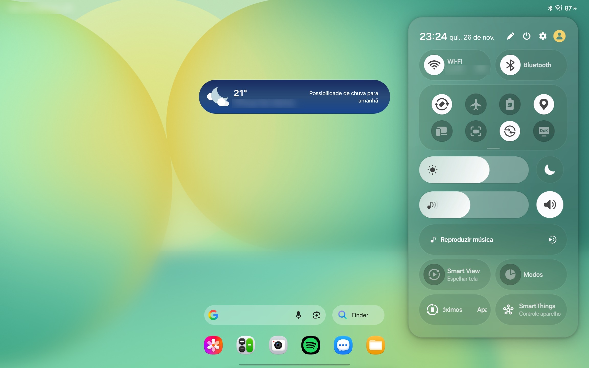
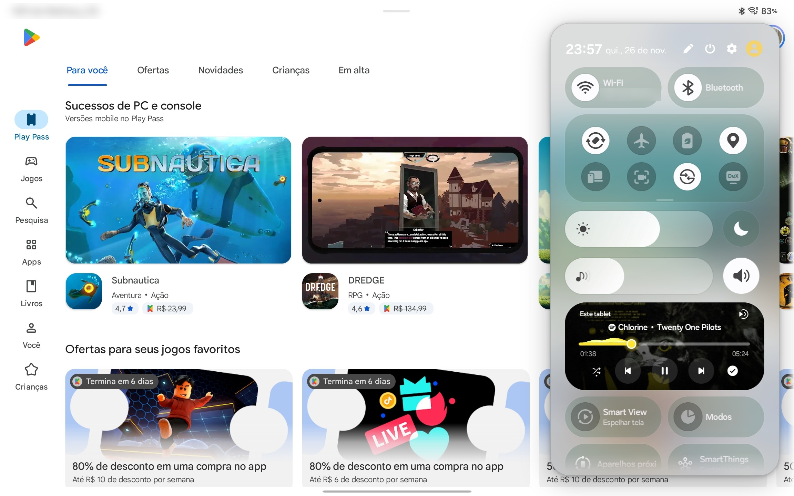
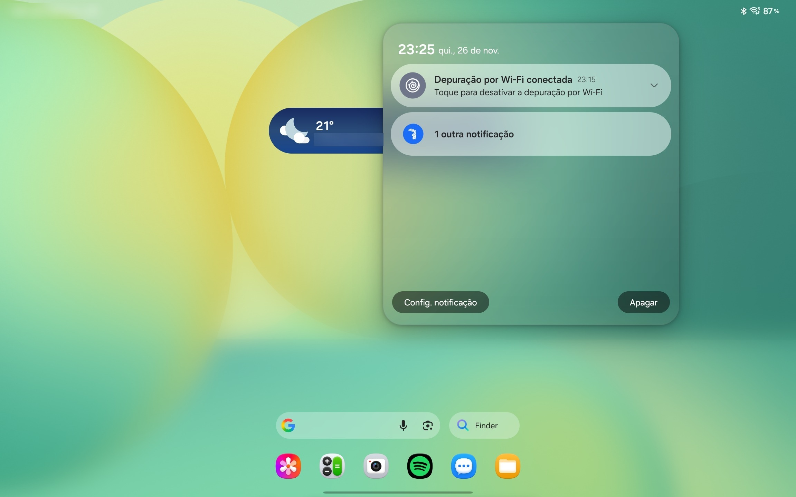
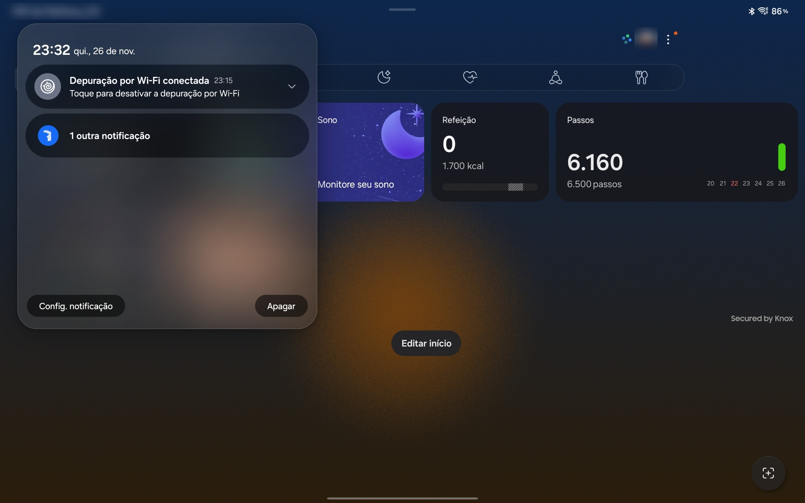
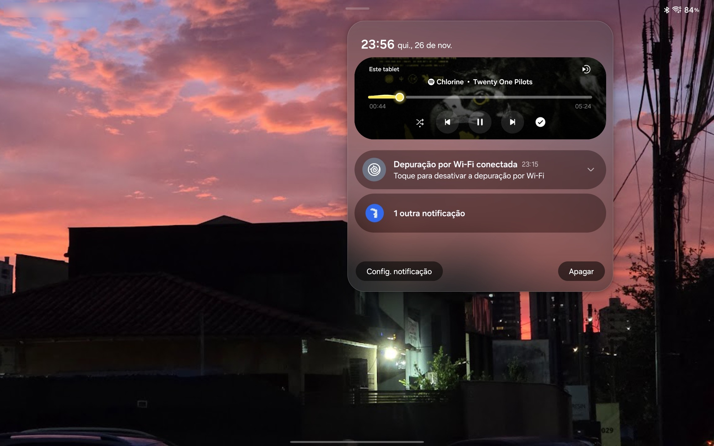
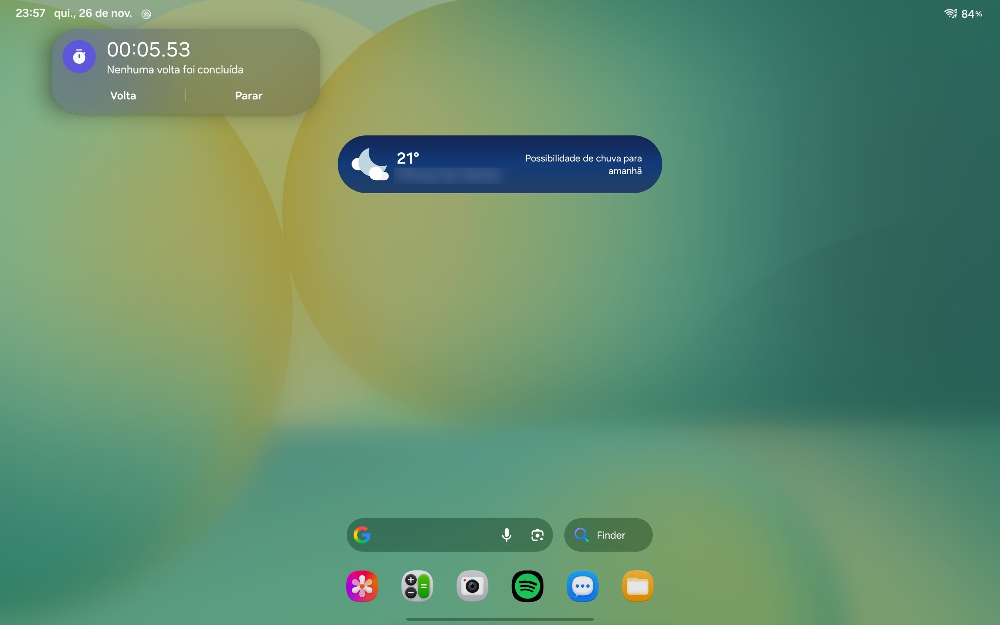
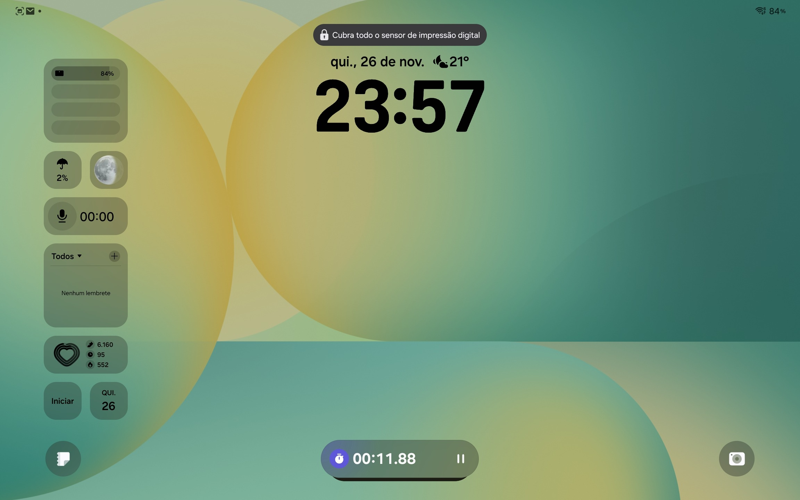
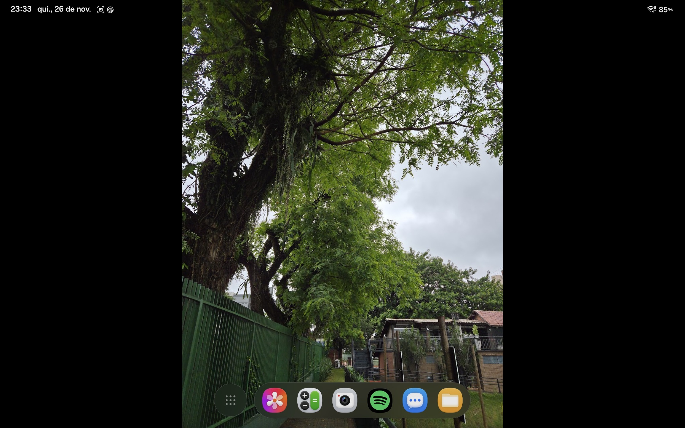

# TabS10FE LiveBlur

**Real-time One UI 9 Live Blur, Flagship `HighEnd` Animations & Frosted Glass for Samsung Galaxy Tab S10 FE (`SM-X520`).**  
**Blur em tempo real da One UI 9, Animações Flagship `HighEnd` e Vidro Fosco para o Samsung Galaxy Tab S10 FE (`SM-X520`).**

[](#english)
[-orange)](#english)
[-1428A0)](#requirements--compatibility)
[-0381FE)](#requirements--compatibility)
[](#requirements--compatibility)

> Jump to: **[English Documentation](#english)** | **[Documentação em Português](#português)**

---

<a name="english"></a>
## English

> [!WARNING]
> **Experimental & Vibecoded Project — Read Before Using!**
> - **Experimental status (`v0.1.0`):** This is an early experimental module, not a mature `1.0` release. Use at your own risk.
> - **100% Vibecoded:** Full transparency — this entire project was **vibecoded by someone with zero programming experience**, built completely through **Antigravity** using **Gemini 4 Neon**. The original goal was simply so I could personally enjoy live blur on my own Tab S10 FE, and I thought it would be cool to share it with the community.
> - **Tested Root Environment:** Developed and tested on a Galaxy Tab S10 FE (`SM-X520`) rooted via the **DirtyFrag exploit (`CVE-2026-43284`)** using **DFRoot** by **diablow**, running **diablow's custom KernelSU build for Samsung devices** alongside **Vector** (Xposed).

### 1. Overview & Problem Solved

On the **Samsung Galaxy Tab S10 FE (`SM-X520`, Exynos 1580 / Xclipse 540 GPU)** running **One UI 9 (Android 17)**, Samsung's `SurfaceFlinger` already ships with the hardware-accelerated `KawaseDualFilterV2` blur pipeline compiled in — however, live background blur and flagship UI animations are artificially disabled across multiple layers:

1. **System properties**: `ro.surface_flinger.supports_background_blur` is omitted from `system.prop`.
2. **Framework & CSC feature flags**: `SemFloatingFeature`, `SemCscFeature`, `ActivityManager.isHighEndGfx()`, and `CrossWindowBlurListeners` report blur/high-end graphics as disabled, and One UI Home animations are set to `LowEnd`.
3. **Zygote-cached `CoreRune` static booleans**: `FW_WINDOW_BLUR_SUPPORTED`, `FW_STACKED_BLUR_SUPPORTED`, and `FW_WINDOW_BLUR_SNAPSHOT_AFTER_PREDRAW` are initialized as `false` before apps launch.
4. **Stubbed native Samsung JNI methods**: In `SM-X520`'s stock `/system/lib64/libandroid_runtime.so`, `SurfaceControl.nativeSetBlurRegionsEx` and `nativeSetBackgroundBlurColorCurve` are compiled as empty no-op stubs, and `nativeSetBlurRegions` zeroes out Samsung's `ColorCurve` fields.

**TabS10FE LiveBlur** solves all four layers cleanly using a minimal **KernelSU/Magisk `system.prop` companion module** paired with a **Vector/LSPosed Xposed module**, unlocking smooth, flagship-grade live blur across the Quick Panel, Notifications, App Drawer, Recents, Lockscreen widgets/shortcuts, DeX taskbar, and 60+ Samsung apps and dialogs — plus `HighEnd` system animations.

---

### Screenshots

| Quick Panel (Wallpaper) | Quick Panel over White App (Play Store) |
| :---: | :---: |
|  |  |

| Notifications (Light Mode) | Notifications (Dark Mode) |
| :---: | :---: |
|  |  |

| Notifications & Media Player (Sunset) | Floating Live Notification & Search Bar |
| :---: | :---: |
|  |  |

| Lockscreen Widgets & Now Bar | Floating Taskbar Blur |
| :---: | :---: |
|  |  |

---

### 2. Requirements & Compatibility

| Requirement | Details |
| :--- | :--- |
| **Tested Device** | Samsung Galaxy Tab S10 FE Wi-Fi (`SM-X520`, Exynos 1580 / Xclipse 540) |
| **OS / Firmware** | One UI 9.0 (Android 17). *May work on `SM-X526B` (5G) or other One UI 9 devices lacking native blur, though tested specifically on `SM-X520`.* |
| **Root Manager** | **KernelSU** or **Magisk** (tested specifically with **DFRoot [DirtyFrag / `CVE-2026-43284`]** by **diablow** and **diablow's custom KernelSU for Samsung devices**; required to apply `magisk-module/system.prop` before `SurfaceFlinger` boots) |
| **Xposed Framework** | **Vector** or **LSPosed** (Xposed API `82+`, `minSdk 31`, `targetSdk 35`) |
| **Runtime Permissions** | None required by the APK itself; requires enabling the module in Vector/LSPosed with its recommended scope (`xposedscope`) |

---

### 3. Architecture & Technical Details

The project is split into two lightweight components:

#### A. Companion KernelSU / Magisk Module (`magisk-module/`)
Sets four properties early at boot via [`magisk-module/system.prop`](magisk-module/system.prop) so `SurfaceFlinger` initializes its `KawaseDualFilterV2` background blur engine:

```properties
ro.surface_flinger.supports_background_blur=1
ro.sf.blurs_are_expensive=0
persist.sys.sf.disable_blurs=0
ro.launcher.blur.appLaunch=1
```

#### B. LSPosed / Vector Module (`app/`)
Entry point registered in [`app/src/main/assets/xposed_init`](app/src/main/assets/xposed_init): `com.teteonauta.tabs10fe.liveblur.LiveBlurHook`.

Core classes:
- **[`LiveBlurHook.kt`](app/src/main/java/com/teteonauta/tabs10fe/liveblur/LiveBlurHook.kt)** — Main `IXposedHookLoadPackage` orchestrator installing feature-flag hooks and the native `setBlurRegionsEx` → `setBlurRegions` bridge.
- **[`CoreRuneFlags.kt`](app/src/main/java/com/teteonauta/tabs10fe/liveblur/CoreRuneFlags.kt)** — Uses `jdk.internal.misc.Unsafe` / `sun.misc.Unsafe` (`putBooleanVolatile`) to flip Zygote-preloaded static `boolean` fields in `com.samsung.android.rune.CoreRune`, with verification and automatic rollback if bridge installation fails.
- **[`BlurRegionEncoder.kt`](app/src/main/java/com/teteonauta/tabs10fe/liveblur/BlurRegionEncoder.kt)** — Encodes Samsung's `android.view.SemBlurRegionData[]` objects into standard AOSP `float[][]` rows (18 or 24 columns), clips regions to the surface viewport, filters out non-empty `Path`-masked regions, applies a gentle vibrancy ceiling (`<= 175px`) to prevent huge Samsung radii (`250–300px`) from washing colors into flat grey in Kawase blur, and deduplicates identical frames via `BlurSubmissionCache`.
- **[`FrostedBlurOverlay.kt`](app/src/main/java/com/teteonauta/tabs10fe/liveblur/FrostedBlurOverlay.kt)** — Hooks `BackgroundBlurDrawable.draw(Canvas)` to synthesize Samsung's missing `SemBlurInfo$ColorCurve` Light/Dark frosted tints for notifications, dialogs, widgets, and system bars; draws a neutral S25-style contrast glass tint, subtle optical specular sheen, and crisp glass border strictly on Quick Panel (`SecQSNewBlurView`); and applies a gentle Dark Mode darkening veil to One UI Home's App Drawer backdrop.

#### Complete Hook Reference

| Target Class | Hooked Method(s) / Field(s) | What It Modifies |
| :--- | :--- | :--- |
| `com.samsung.android.feature.SemFloatingFeature` | `getBoolean(...)`, `getString(...)` | Forces blur, 3D surface transition, and high-end UX/animation keys to `true` / `"TRUE"`; overrides `SEC_FLOATING_FEATURE_{LAUNCHER,COMMON,SYSTEMUI}_CONFIG_ANIMATION_TYPE` to `"HighEnd"`. Excludes any key containing `DISABLE`, `LOW_END`, `LOWEND`, or `LEGACY`. |
| `com.samsung.android.feature.SemCscFeature` | `getBoolean(...)`, `getString(...)` | Forces Samsung CSC blur, 3D surface transition, and high-end UX keys to `true` / `"TRUE"`. |
| `android.os.SystemProperties` | `getBoolean(...)`, `getInt(...)`, `get(...)` | Mirrors `ro.surface_flinger.supports_background_blur=1`, `ro.sf.blurs_are_expensive=0`, `persist.sys.sf.disable_blurs=0`, and `ro.launcher.blur.appLaunch=1` inside hooked processes. |
| `android.view.CrossWindowBlurListeners` | Static field `CROSS_WINDOW_BLUR_SUPPORTED`, method `isCrossWindowBlurEnabled()` | Sets static field to `true` and returns `true` so standard Android cross-window blur listeners stay active. |
| `android.app.ActivityManager` | `isHighEndGfx()` | Returns `true` so SystemUI, Launcher, and Samsung apps enable flagship rendering paths. |
| `com.samsung.android.rune.CoreRune` | Static fields `FW_WINDOW_BLUR_SUPPORTED`, `FW_STACKED_BLUR_SUPPORTED`, `FW_WINDOW_BLUR_SNAPSHOT_AFTER_PREDRAW`, `FW_RESPECT_LIGHT_APPEARANCE_OF_BLURRING_WINDOW` | Flipped to `true` via `Unsafe.putBooleanVolatile` (with automatic rollback on error). |
| `android.view.ViewRootImpl` | `dispatchBlurRegionsEx(SemBlurRegionData[], long)` | Pre-encodes visible blur regions via `BlurRegionEncoder.encodeVisible(...)`, skips duplicate frames via `BlurSubmissionCache`, and caches prepared rows in a `ThreadLocal` for the transaction. |
| `android.view.SurfaceControl$Transaction` | `setBlurRegionsEx(SurfaceControl, SemBlurRegionData[])` | Replaces the stubbed Samsung JNI call by invoking standard `SurfaceControl$Transaction.setBlurRegions(SurfaceControl, float[][])`. |
| `android.view.View` | `semSetBlurInfo(SemBlurInfo)`, `invalidateBlurBackground()` | Forces ART deoptimization so methods don't keep stale inlined `CoreRune` booleans; tags `BackgroundBlurDrawable` instances belonging to `SecQSNewBlurView`, `Notification*`, and `Dialog`/`Popup`/`Menu` views. |
| `com.android.internal.graphics.drawable.BackgroundBlurDrawable` | `draw(Canvas)` | Synthesizes Light/Dark frosted tints from `SemBlurInfo$ColorCurve` (`mMinY`, `mMaxY`, `mCurveBias`), adds neutral Quick Panel contrast glass + optical sheen + crisp border, adds subtle Dark Mode veil in One UI Home App Drawer, and skips `mClipPath`-masked drawables. |

#### Target Scope (`app/src/main/res/values/arrays.xml` — 68 Packages)

<details>
<summary><strong>Click to expand all 68 recommended packages in <code>xposedscope</code></strong></summary>

- **Core System, SystemUI, Launcher & Settings (4):**  
  `android`, `com.android.systemui`, `com.sec.android.app.launcher`, `com.android.settings`
- **Core Samsung Apps (25):**  
  `com.sec.android.gallery3d`, `com.sec.android.app.clockpackage`, `com.sec.android.app.myfiles`, `com.samsung.android.app.notes`, `com.samsung.android.calendar`, `com.samsung.android.app.contacts`, `com.samsung.android.app.reminder`, `com.samsung.android.app.routines`, `com.sec.android.app.popupcalculator`, `com.sec.android.app.voicenote`, `com.sec.android.app.sbrowser`, `com.sec.android.app.camera`, `com.sec.android.daemonapp`, `com.samsung.android.dialer`, `com.samsung.android.messaging`, `com.samsung.android.honeyboard`, `com.samsung.android.oneconnect`, `com.sec.android.app.shealth`, `com.sec.android.app.samsungapps`, `com.samsung.android.goodlock`, `com.samsung.android.lool`, `com.samsung.android.forest`, `com.samsung.android.video`, `com.sec.android.mimage.photoretouching`, `com.samsung.app.newtrim`
- **System UI Extensions, Popups, Air Command & Dialogs (39):**  
  `com.samsung.accessibility`, `com.samsung.android.app.clipboardedge`, `com.samsung.android.app.clockpack`, `com.samsung.android.app.dressroom`, `com.samsung.android.app.find`, `com.samsung.android.app.homestar`, `com.samsung.android.app.sharelive`, `com.samsung.android.app.smartcapture`, `com.samsung.android.app.soundpicker`, `com.samsung.android.app.taskedge`, `com.samsung.android.app.telephonyui`, `com.samsung.android.biometrics.app.setting`, `com.samsung.android.dynamiclock`, `com.samsung.android.edgelightingplus`, `com.samsung.android.game.gamehome`, `com.samsung.android.game.gametools`, `com.samsung.android.incallui`, `com.samsung.android.privacydashboard`, `com.samsung.android.qstuner`, `com.samsung.android.samsungpass`, `com.samsung.android.scloud`, `com.samsung.android.secsoundpicker`, `com.samsung.android.service.aircommand`, `com.samsung.android.service.peoplestripe`, `com.samsung.android.setting.multisound`, `com.samsung.android.sm.devicesecurity`, `com.samsung.android.smartmirroring`, `com.samsung.android.soundassistant`, `com.samsung.android.stickercenter`, `com.samsung.android.themecenter`, `com.samsung.android.themestore`, `com.samsung.android.widget.pictureframe`, `com.samsung.knox.securefolder`, `com.samsung.systemui.lockstar`, `com.samsung.systemui.navillera`, `com.sec.android.app.quicktool`, `com.sec.android.app.soundalive`, `com.sec.android.easyMover`

</details>

---

### 4. Current Limitations & Known Issues

- **Lockscreen Blur Clock (`Path`-masked regions):** Standard Android `SurfaceControl$Transaction.setBlurRegions(float[][])` only supports rounded rectangles and cannot clip blur to arbitrary `android.graphics.Path` vector outlines (used by One UI 9's lockscreen blur clock digits). To prevent the lockscreen clock from blurring the entire screen (`0,0-2304,1440`), `BlurRegionEncoder` and `FrostedBlurOverlay` intentionally skip regions with a non-empty `Path` / `mClipPath`. As a result, the lockscreen blur clock style itself does not render live blur.
- **No native GPU `ColorCurve` / saturation shader in stock `libandroid_runtime.so`:** Because Samsung compiled `nativeSetBackgroundBlurColorCurve` as a no-op stub and zeroes out `BlurRegion.colorCurve` on `SM-X520`, Light/Dark frosted tints are synthesized via `Canvas` in `FrostedBlurOverlay` rather than inside SurfaceFlinger's fragment shader.
- **Companion KernelSU/Magisk module is mandatory:** Installing only the Xposed APK without `magisk-module` will cause panels to become translucent with no actual GPU blur, because `SurfaceFlinger` checks `ro.surface_flinger.supports_background_blur` at boot.
- **Reboot / Process restart required:** Changes to the module or its scope require restarting the target app/SystemUI (or a full reboot) to take effect.
- **Scoped packages only:** Apps outside the LSPosed/Vector scope will not receive live blur or `HighEnd` flags unless manually checked in the scope list.
- **GPU overhead:** Real-time multi-pass Kawase blur increases GPU compositing workload slightly compared to stock dim overlays.

---

### 5. Installation

1. Download the latest **APK** (`TabS10FELiveBlur-*.apk`) and the companion **KernelSU/Magisk ZIP** (`TabS10FE-LiveBlur-SurfaceFlinger-*.zip`) from the **[Releases](../../releases)** page.
2. Open **KernelSU** (or **Magisk**) → **Modules** → **Install from storage** → select the `TabS10FE-LiveBlur-SurfaceFlinger-*.zip` file.
3. Install the `TabS10FELiveBlur-*.apk` file on your tablet.
4. Open **Vector** (or **LSPosed**) → **Modules** → enable **`TabS10FELiveBlur`** → tap the menu (**⋮**) → **Apply recommended scope** (make sure `android`, `com.android.systemui`, and `com.sec.android.app.launcher` are checked).
5. **Reboot your tablet** (full reboot so `SurfaceFlinger` picks up the new `system.prop` flags).

---

### 6. Building from Source

#### Prerequisites
- **JDK 17 or JDK 21** (e.g., Eclipse Temurin 21 LTS)
- **Android SDK** with `platforms;android-35` and `build-tools;35.0.0`

#### Build the LSPosed / Vector APK
```bash
git clone https://github.com/teteonauta/TabS10FE-LiveBlur.git
cd TabS10FE-LiveBlur

# Point Gradle to your Android SDK (this file is gitignored)
echo "sdk.dir=/path/to/your/Android/Sdk" > local.properties

# Build Debug or Release APK
./gradlew :app:assembleDebug
# or
./gradlew :app:assembleRelease
```
The output APK will be located at `app/build/outputs/apk/debug/` (or `release/`).

#### Package the Companion KernelSU / Magisk ZIP
```bash
cd magisk-module
zip -r ../TabS10FE-LiveBlur-SurfaceFlinger.zip .
```

---

### 7. Credits & References

- **DFRoot (`DirtyFrag`, `CVE-2026-43284`) & Custom Samsung KernelSU** by **diablow** — Root exploit & custom KernelSU environment used on the test Galaxy Tab S10 FE (`SM-X520`).
- **[OneUI-9-Native-Blur](https://github.com/RaphaelSolis/OneUI-9-Native-Blur)** by **RaphaelSolis** — Primary architectural reference for bridging Samsung's `setBlurRegionsEx` to standard `setBlurRegions` and flipping Zygote-preloaded `CoreRune` blur flags via `Unsafe`.
- **[glass-ui](https://github.com/AurelioMo/glass-ui)** by **AurelioMo** — Consulted as visual reference for One UI 9 frosted glass styling.
- **[Xposed Framework API 82](https://api.xposed.info/)** (`de.robv.android.xposed:api:82`) by **rovo89** — Core hooking API used by the module.
- **[LSPosed](https://github.com/LSPosed/LSPosed)** & **Vector** — Modern ART/Zygisk Xposed frameworks.
- **[KernelSU](https://github.com/tiann/KernelSU)** & **[Magisk](https://github.com/topjohnwu/Magisk)** — Root & early-boot `system.prop` module infrastructure.
- **Antigravity + Gemini 4 Neon** — Used to vibecode and iterate on this entire project.

---
---

<a name="português"></a>
## Português

> [!WARNING]
> **Módulo Experimental & Vibecodado — Leia Antes de Usar!**
> - **Status experimental (`v0.1.0`):** Este é um módulo experimental em estágio inicial (não é uma versão `1.0` final). Use por sua conta e risco.
> - **100% Vibecodado:** Com total transparência — tudo neste projeto foi **vibecodado por alguém sem nenhuma experiência em programação**, feito totalmente pelo **Antigravity** usando o **Gemini 4 Neon**. O objetivo inicial era apenas que eu pessoalmente pudesse ter o blur em tempo real no meu Tab S10 FE, mas achei que seria legal compartilhar com todo mundo!
> - **Ambiente de Root Testado:** Desenvolvido e testado em um Galaxy Tab S10 FE (`SM-X520`) rooteado com o **exploit DirtyFrag (`CVE-2026-43284`)**, usando o **DFRoot** do **diablow** junto com a **versão customizada do KernelSU para dispositivos Samsung** feita por ele, além do **Vector** (Xposed).

### 1. Visão Geral e Problema Resolvido

No **Samsung Galaxy Tab S10 FE (`SM-X520`, Exynos 1580 / GPU Xclipse 540)** rodando **One UI 9 (Android 17)**, o `SurfaceFlinger` já vem com o filtro de blur por GPU `KawaseDualFilterV2` compilado nativamente — porém a Samsung desativa o blur em tempo real e as animações de linha flagship em quatro camadas distintas:

1. **Propriedades de sistema:** `ro.surface_flinger.supports_background_blur` não existe no `system.prop` padrão.
2. **Flags de framework e CSC:** `SemFloatingFeature`, `SemCscFeature`, `ActivityManager.isHighEndGfx()` e `CrossWindowBlurListeners` informam que o dispositivo não suporta blur/gráficos avançados, e o tipo de animação da One UI Home vem definido como `LowEnd`.
3. **Booleanos estáticos de `CoreRune` carregados no Zygote:** `FW_WINDOW_BLUR_SUPPORTED`, `FW_STACKED_BLUR_SUPPORTED` e `FW_WINDOW_BLUR_SNAPSHOT_AFTER_PREDRAW` já nascem como `false` antes dos apps abrirem.
4. **Métodos JNI proprietários compilados como *stubs* vazios:** na `/system/lib64/libandroid_runtime.so` original do `SM-X520`, `SurfaceControl.nativeSetBlurRegionsEx` e `nativeSetBackgroundBlurColorCurve` são funções vazias (*no-op*), e `nativeSetBlurRegions` zera os campos de `ColorCurve` da Samsung.

O **TabS10FE LiveBlur** resolve todas essas camadas combinando um **módulo complementar minimalista do KernelSU/Magisk (`system.prop`)** com um **módulo Xposed para Vector/LSPosed**, ativando blur nativo em tempo real no Painel Rápido, Notificações, Gaveta de Apps, Recentes, widgets e atalhos da tela de bloqueio, barra do DeX e em mais de 60 apps e diálogos da Samsung — além das animações `HighEnd` de flagship.

---

### Capturas de Tela

| Painel Rápido (Papel de Parede) | Painel Rápido sobre App Branco (Play Store) |
| :---: | :---: |
|  |  |

| Notificações (Modo Claro) | Notificações (Modo Escuro) |
| :---: | :---: |
|  |  |

| Notificações e Player de Mídia | Notificação Flutuante e Barra de Busca |
| :---: | :---: |
|  |  |

| Widgets da Tela de Bloqueio e Now Bar | Blur na Barra de Tarefas Flutuante |
| :---: | :---: |
|  |  |

---

### 2. Requisitos e Compatibilidade

| Requisito | Detalhes |
| :--- | :--- |
| **Dispositivo Testado** | Samsung Galaxy Tab S10 FE Wi-Fi (`SM-X520`, Exynos 1580 / Xclipse 540) |
| **Sistema / One UI** | One UI 9.0 (Android 17). *Pode funcionar no `SM-X526B` (5G) ou outros Samsung com One UI 9 sem blur nativo, mas foi testado especificamente no `SM-X520`.* |
| **Gerenciador de Root** | **KernelSU** ou **Magisk** (testado especificamente com o **DFRoot [DirtyFrag / `CVE-2026-43284`]** do **diablow** e sua **versão customizada do KernelSU para dispositivos Samsung**; necessário para aplicar o `magisk-module/system.prop` antes do `SurfaceFlinger` iniciar) |
| **Framework Xposed** | **Vector** ou **LSPosed** (Xposed API `82+`, `minSdk 31`, `targetSdk 35`) |
| **Permissões** | O APK não solicita permissões em tempo de execução; basta ativá-lo no Vector/LSPosed aplicando o escopo recomendado (`xposedscope`) |

---

### 3. Arquitetura e Detalhes Técnicos

O projeto é dividido em dois componentes leves:

#### A. Módulo Complementar KernelSU / Magisk (`magisk-module/`)
Define 4 propriedades no boot via [`magisk-module/system.prop`](magisk-module/system.prop) para o `SurfaceFlinger` ativar o motor `KawaseDualFilterV2`:

```properties
ro.surface_flinger.supports_background_blur=1
ro.sf.blurs_are_expensive=0
persist.sys.sf.disable_blurs=0
ro.launcher.blur.appLaunch=1
```

#### B. Módulo LSPosed / Vector (`app/`)
Ponto de entrada declarado em [`app/src/main/assets/xposed_init`](app/src/main/assets/xposed_init): `com.teteonauta.tabs10fe.liveblur.LiveBlurHook`.

Classes principais:
- **[`LiveBlurHook.kt`](app/src/main/java/com/teteonauta/tabs10fe/liveblur/LiveBlurHook.kt)** — Orquestrador `IXposedHookLoadPackage` que instala os hooks de flags e a ponte nativa `setBlurRegionsEx` → `setBlurRegions`.
- **[`CoreRuneFlags.kt`](app/src/main/java/com/teteonauta/tabs10fe/liveblur/CoreRuneFlags.kt)** — Usa `jdk.internal.misc.Unsafe` / `sun.misc.Unsafe` (`putBooleanVolatile`) para alterar em memória os campos estáticos pré-carregados pelo Zygote em `com.samsung.android.rune.CoreRune`, com verificação de escrita e *rollback* automático em caso de erro.
- **[`BlurRegionEncoder.kt`](app/src/main/java/com/teteonauta/tabs10fe/liveblur/BlurRegionEncoder.kt)** — Converte `android.view.SemBlurRegionData[]` da Samsung em matrizes `float[][]` padrão do AOSP (18 ou 24 colunas), recorta regiões aos limites da superfície, filtra regiões com máscara `Path` não-vazia, aplica um teto suave de raio (`<= 175px`) para evitar que raios enormes da Samsung (`250–300px`) transformem cores vivas em cinza lavado no filtro Kawase, e evita envios duplicados por quadro usando `BlurSubmissionCache`.
- **[`FrostedBlurOverlay.kt`](app/src/main/java/com/teteonauta/tabs10fe/liveblur/FrostedBlurOverlay.kt)** — Intercepta `BackgroundBlurDrawable.draw(Canvas)` para sintetizar o efeito de vidro fosco claro/escuro do `SemBlurInfo$ColorCurve` (notificações, diálogos, widgets e barras); aplica contraste neutro estilo S25, reflexo ótico sutil e borda nítida exclusivamente no Painel Rápido (`SecQSNewBlurView`); e adiciona um véu escuro suave na gaveta de apps da One UI Home no modo escuro.

#### Tabela Completa de Hooks

| Classe-Alvo | Método(s) / Campo(s) Interceptado(s) | O que é Alterado |
| :--- | :--- | :--- |
| `com.samsung.android.feature.SemFloatingFeature` | `getBoolean(...)`, `getString(...)` | Força flags de blur, transição 3D e UX/animação high-end para `true` / `"TRUE"`; sobrescreve `SEC_FLOATING_FEATURE_{LAUNCHER,COMMON,SYSTEMUI}_CONFIG_ANIMATION_TYPE` para `"HighEnd"`. Ignora chaves contendo `DISABLE`, `LOW_END`, `LOWEND` ou `LEGACY`. |
| `com.samsung.android.feature.SemCscFeature` | `getBoolean(...)`, `getString(...)` | Força chaves CSC de blur, transição 3D e UX high-end para `true` / `"TRUE"`. |
| `android.os.SystemProperties` | `getBoolean(...)`, `getInt(...)`, `get(...)` | Espelha `ro.surface_flinger.supports_background_blur=1`, `ro.sf.blurs_are_expensive=0`, `persist.sys.sf.disable_blurs=0` e `ro.launcher.blur.appLaunch=1` dentro dos processos no escopo. |
| `android.view.CrossWindowBlurListeners` | Campo estático `CROSS_WINDOW_BLUR_SUPPORTED`, método `isCrossWindowBlurEnabled()` | Define o campo como `true` e força retorno `true` para manter os listeners padrão de blur entre janelas ativos. |
| `android.app.ActivityManager` | `isHighEndGfx()` | Retorna `true` para que SystemUI, Launcher e apps Samsung usem o perfil gráfico flagship. |
| `com.samsung.android.rune.CoreRune` | Campos estáticos `FW_WINDOW_BLUR_SUPPORTED`, `FW_STACKED_BLUR_SUPPORTED`, `FW_WINDOW_BLUR_SNAPSHOT_AFTER_PREDRAW`, `FW_RESPECT_LIGHT_APPEARANCE_OF_BLURRING_WINDOW` | Alterados para `true` via `Unsafe.putBooleanVolatile` (com *rollback* automático se ocorrer falha). |
| `android.view.ViewRootImpl` | `dispatchBlurRegionsEx(SemBlurRegionData[], long)` | Pré-codifica as regiões visíveis via `BlurRegionEncoder.encodeVisible(...)`, pula quadros idênticos via `BlurSubmissionCache` e guarda o resultado em `ThreadLocal` para a transação. |
| `android.view.SurfaceControl$Transaction` | `setBlurRegionsEx(SurfaceControl, SemBlurRegionData[])` | Substitui o método JNI vazio da Samsung invocando diretamente o método padrão `SurfaceControl$Transaction.setBlurRegions(SurfaceControl, float[][])`. |
| `android.view.View` | `semSetBlurInfo(SemBlurInfo)`, `invalidateBlurBackground()` | Força a desotimização do ART para que métodos compilados não retenham valores antigos de `CoreRune`; marca os `BackgroundBlurDrawable` pertencentes a `SecQSNewBlurView`, `Notification*` e `Dialog`/`Popup`/`Menu`. |
| `com.android.internal.graphics.drawable.BackgroundBlurDrawable` | `draw(Canvas)` | Sintetiza o vidro fosco claro/escuro a partir de `SemBlurInfo$ColorCurve` (`mMinY`, `mMaxY`, `mCurveBias`), desenha contraste neutro + reflexo ótico + contorno nítido no Painel Rápido, véu escuro suave na gaveta de apps no modo escuro e pula drawables com `mClipPath`. |

#### Pacotes-Alvo (`app/src/main/res/values/arrays.xml` — 68 Pacotes)

> Veja a lista completa dos **68 pacotes recomendados** (Sistema/SystemUI/Launcher/Configurações + 25 apps Samsung principais + 39 extensões, popups e diálogos da One UI) na seção expansível acima em [`Target Scope`](#target-scope-appsrcmainresvaluesarraysxml--68-packages).

---

### 4. Limitações Atuais e Problemas Conhecidos

- **Relógio com Blur na Tela de Bloqueio (máscaras `Path`):** O método padrão `SurfaceControl$Transaction.setBlurRegions(float[][])` suporta apenas retângulos arredondados, e não máscaras vetoriais arbitrárias (`android.graphics.Path`) usadas nos dígitos do relógio com blur da One UI 9. Para evitar que o relógio borre a tela de bloqueio inteira (`0,0-2304,1440`), `BlurRegionEncoder` e `FrostedBlurOverlay` ignoram propositalmente regiões com `Path` / `mClipPath` não-vazios — logo, o efeito de blur específico nos dígitos desse relógio não é exibido.
- **Ausência de shader nativo de `ColorCurve` / saturação na `libandroid_runtime.so` stock:** Como a Samsung compilou `nativeSetBackgroundBlurColorCurve` como *stub* vazio e zera o `ColorCurve` em `nativeSetBlurRegions` no `SM-X520`, os tons de vidro fosco claro/escuro são sintetizados em `Canvas` pelo `FrostedBlurOverlay`, e não dentro do shader do `SurfaceFlinger`.
- **Dependência obrigatória do módulo KernelSU/Magisk:** Instalar apenas o APK no Vector/LSPosed sem o módulo de `system.prop` deixa os painéis transparentes sem desfoque real, pois o `SurfaceFlinger` lê `ro.surface_flinger.supports_background_blur` durante o boot.
- **Necessidade de reiniciar SystemUI / dispositivo:** Atualizações do módulo ou mudanças no escopo exigem reiniciar os processos-alvo (ou reiniciar o tablet) para entrar em vigor.
- **Atuação restrita aos pacotes no escopo:** Apps fora do escopo selecionado no Vector/LSPosed não recebem hooks de blur nem de gráficos `HighEnd`.
- **Consumo adicional de GPU:** O blur Kawase em tempo real adiciona uma carga gráfica moderada na GPU Xclipse 540 em comparação ao escurecimento estático original.

---

### 5. Instalação

1. Baixe o **APK** mais recente (`TabS10FELiveBlur-*.apk`) e o **ZIP complementar do KernelSU/Magisk** (`TabS10FE-LiveBlur-SurfaceFlinger-*.zip`) na aba **[Releases](../../releases)**.
2. Abra o **KernelSU** (ou **Magisk**) → **Módulos** → **Instalar do armazenamento** → selecione `TabS10FE-LiveBlur-SurfaceFlinger-*.zip`.
3. Instale o `TabS10FELiveBlur-*.apk` normalmente no tablet.
4. Abra o **Vector** (ou **LSPosed**) → **Módulos** → ative **`TabS10FELiveBlur`** → toque no menu (**⋮**) → **Aplicar escopo recomendado** (confira se `android`, `com.android.systemui` e `com.sec.android.app.launcher` estão marcados).
5. **Reinicie o tablet** (reinicialização completa para que o `SurfaceFlinger` carregue o `system.prop`).

---

### 6. Compilando a partir do Código-Fonte

#### Pré-requisitos
- **JDK 17 ou JDK 21** (ex.: Eclipse Temurin 21 LTS)
- **Android SDK** com `platforms;android-35` e `build-tools;35.0.0`

#### Compilar o APK (LSPosed / Vector)
```bash
git clone https://github.com/teteonauta/TabS10FE-LiveBlur.git
cd TabS10FE-LiveBlur

# Aponte o Gradle para o seu Android SDK (arquivo ignorado pelo .gitignore)
echo "sdk.dir=/caminho/para/seu/Android/Sdk" > local.properties

# Compilar APK Debug ou Release
./gradlew :app:assembleDebug
# ou
./gradlew :app:assembleRelease
```
O APK gerado ficará em `app/build/outputs/apk/debug/` (ou `release/`).

#### Empacotar o Módulo Complementar KernelSU / Magisk
```bash
cd magisk-module
zip -r ../TabS10FE-LiveBlur-SurfaceFlinger.zip .
```

---

### 7. Créditos e Referências

- **DFRoot (`DirtyFrag`, `CVE-2026-43284`) e KernelSU Customizado para Samsung** por **diablow** — Exploit de root e versão customizada do KernelSU utilizados nos testes no Galaxy Tab S10 FE (`SM-X520`).
- **[OneUI-9-Native-Blur](https://github.com/RaphaelSolis/OneUI-9-Native-Blur)** por **RaphaelSolis** — Referência arquitetural principal para a ponte `setBlurRegionsEx` → `setBlurRegions` e alteração volátil dos campos estáticos de `CoreRune` via `Unsafe`.
- **[glass-ui](https://github.com/AurelioMo/glass-ui)** por **AurelioMo** — Consultado como referência visual para estilização de vidro da One UI 9.
- **[Xposed Framework API 82](https://api.xposed.info/)** (`de.robv.android.xposed:api:82`) por **rovo89** — API base de hooks utilizada pelo módulo.
- **[LSPosed](https://github.com/LSPosed/LSPosed)** e **Vector** — Frameworks Xposed modernos baseados em ART/Zygisk.
- **[KernelSU](https://github.com/tiann/KernelSU)** e **[Magisk](https://github.com/topjohnwu/Magisk)** — Infraestrutura de root e carregamento de `system.prop` no início do boot.
- **Antigravity + Gemini 4 Neon** — Ferramenta e modelo usados para vibecodar todo este projeto.
